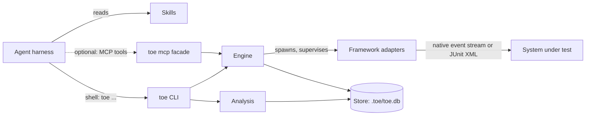

# 0001: Architecture overview

Status: Proposed. Amended by [0014](0014-central-store-and-server.md): the store moves out of the workspace into one toe home; still no daemon or service. Amended by [0013](0013-black-box-adoption.md): `toe.toml` is optional; `toe run -- <command>` is first-class.

## Context

Agent harnesses run tests with ad hoc shell commands, dump output to files, lose track of what ran with which parameters, and block on long timeouts. toe gives them one structured entry point, a recorded history, and a formal experiment loop. `diagram.svg` shows a single box, "toe (skills)": the agent meets toe through skills.

## Decision

toe is one Rust binary plus a set of skills.

Components, all inside the one binary:

- **Engine**: run lifecycle, process supervision, liveness watchdog, cancellation. Owns the state machines of [0002](0002-formal-model.md) and [0007](0007-experiments.md).
- **Adapters**: one per test framework. Translate native output into toe events ([0003](0003-event-stream-and-junit.md)).
- **Store**: SQLite file in the workspace ([0008](0008-storage-sqlite.md)).
- **Analysis**: flake statistics, duration regressions, experiment verdicts ([0006](0006-identity-history-flakiness.md), [0007](0007-experiments.md)).
- **Conduit**: CLI first, MCP facade second ([0009](0009-conduit-cli-plus-mcp.md)).
- **Skills**: teach the agent the loop and the per-language setup ([0012](0012-skills-packaging.md)).

Workspace layout in a system under test:

- `toe.toml`: committed. Declares suites (adapter, command, size, selection) and experiment defaults. This is the "single point of execution": the agent runs `toe run <suite>`, never the raw test command.
- `.toe/`: not committed. `toe.db` and content-addressed artifacts (raw output, JUnit files).

No long-lived daemon. `toe run --detach` starts one supervisor process per run; other `toe` invocations read and write the same store.

Cargo workspace: `toe-core` (model, engine, store, analysis), `toe-adapters`, `toe-cli` (binary, includes `toe mcp`).

## Consequences

- One artifact to install; no service to keep alive.
- Engine logic is testable without any harness.
- Per-run supervisor means crash of one run cannot corrupt another; store must tolerate concurrent processes.

## Alternatives

- Daemon plus thin client: needed only for a UI or remote access. Not now.
- Library per language instead of a binary: multiplies maintenance by language count.
