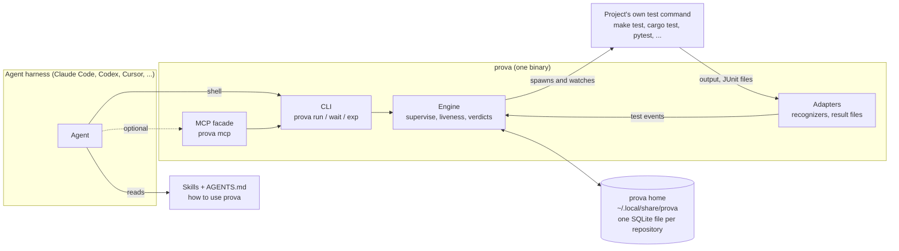
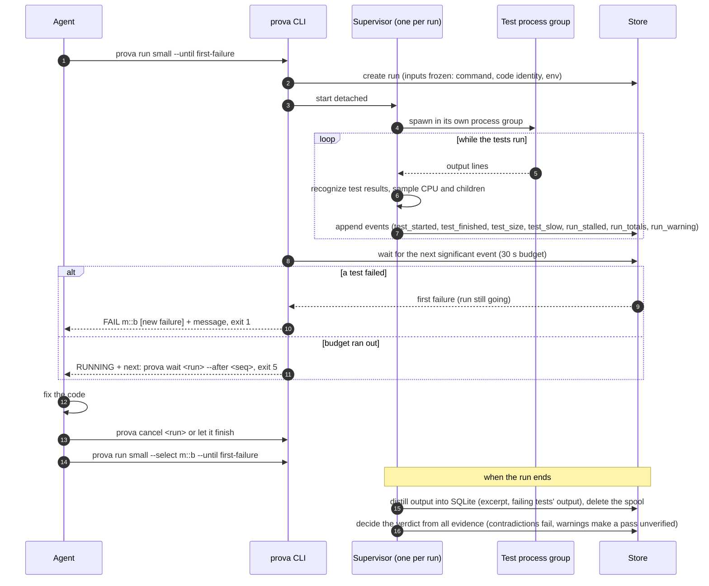
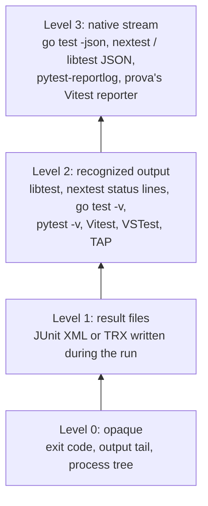
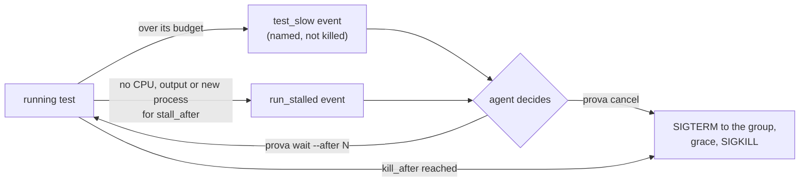
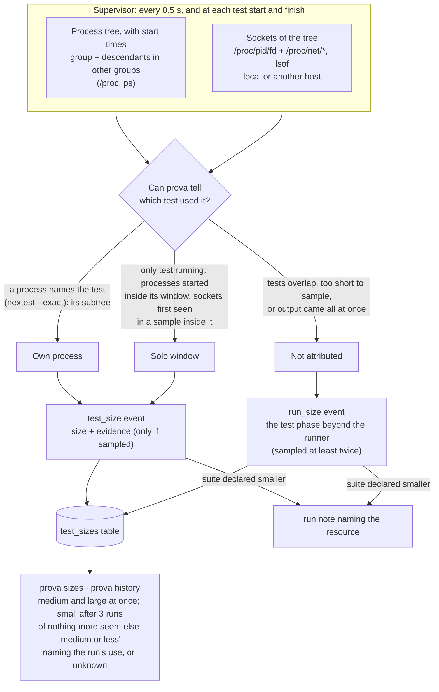
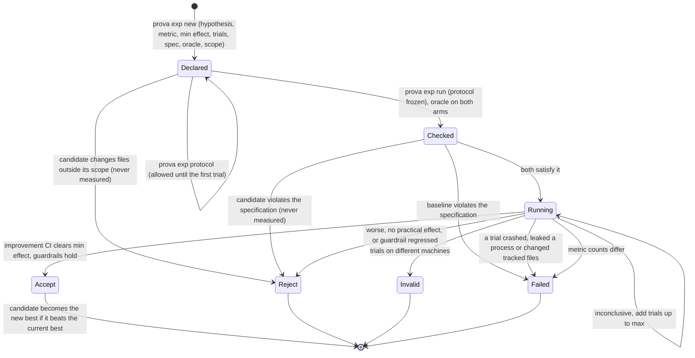
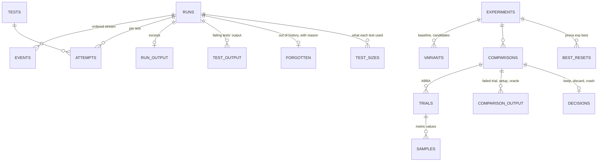

# Architecture

This document explains how prova works, for people and for coding agents.
It describes what prova does and why it is built that way.

- [The idea in one picture](#the-idea-in-one-picture)
- [Components and code map](#components-and-code-map)
- [The test loop](#the-test-loop)
- [Seeing tests: the fidelity ladder](#seeing-tests-the-fidelity-ladder)
- [Liveness: slow, stalled, killed](#liveness-slow-stalled-killed)
- [Memory: history and flaky tests](#memory-history-and-flaky-tests)
- [Experiments](#experiments)
- [Storage](#storage)
- [Deployment](#deployment)
- [Contracts for agents](#contracts-for-agents)
- [Invariants and where they are enforced](#invariants-and-where-they-are-enforced)

## The idea in one picture

Agents run tests badly: ad hoc shell commands, output dumped to files, long
timeouts, no memory of what failed before. prova puts one small binary between
the agent and the project's own test command. It runs that command, watches it,
tells the agent as soon as something needs attention, and remembers every run.



There is no daemon. `prova run` starts one supervisor process per run; every
other command reads and writes the same store directly.

## Components and code map

| Component | Code | Owns |
|---|---|---|
| Contract types | `crates/prova-core/src/model.rs`, `schemas/` | events, outcomes, fidelity levels; JSON Schema is generated and checked in CI |
| Lifecycle | `crates/prova-core/src/lifecycle.rs`, `spec/run.qnt` | which run transitions are legal; mirrors the Quint spec |
| Engine | `crates/prova-core/src/engine.rs` | creating runs, the supervisor, `wait`, summaries |
| Process control | `crates/prova-core/src/process.rs` | process groups and trees, CPU and child sampling from `/proc`, signals |
| Resources | `crates/prova-core/src/resources.rs` | processes and sockets per sample, test sizes (ADR 0025) |
| Store | `crates/prova-core/src/store.rs`, `migrations/` | SQLite schema and triggers that re-enforce the spec |
| Home and identity | `crates/prova-core/src/home.rs`, `identity.rs` | where data lives, repository identity, code identity, run origin |
| Output | `crates/prova-core/src/output.rs` | distilling a run's output into SQLite at its end; the 64 MB budget per repository |
| Analysis | `crates/prova-core/src/analysis.rs` | history, flake statistics, run diffs, observed sizes |
| Experiments | `crates/prova-core/src/experiment.rs`, `stats.rs`, `spec/experiment.qnt` | protocol, checkouts, trials, Mann-Whitney + Hodges-Lehmann verdicts, the evidence export (`exp_export.rs`); one hidden `prova __exp` worker per comparison |
| Adapters | `crates/prova-adapters/src/` | recognizing live output, JUnit/TRX parsing, `prova adopt` detection (`adopt.rs`), opt-in injection recipes (`inject.rs`), benchmark metrics (`bench.rs`) |
| CLI | `crates/prova-cli/src/main.rs`, `render.rs` | commands, exit codes, compact output |
| MCP facade | `crates/prova-cli/src/mcp.rs` | five tools that call the CLI with `--json` |
| Skills | `skills/`, embedded by `crates/prova-cli/src/skills.rs` | instructions agents load: workflows and one per language |
| Fixtures | `fixtures/` | one realistic project per supported language, used by large tests |

Dependency direction: `prova-cli` → `prova-adapters` → `prova-core`. The engine knows
nothing about frameworks; adapters plug in through the `Observer` trait.

## The test loop

The loop an agent runs, and what happens underneath:



One command per intent ([ADR 0019](adr/0019-one-command-per-intent.md)):
`prova run <suite> --until ...` starts the run and waits in the same call.

- `--until first-failure` (the default for `prova wait`, 30 s budget) returns
  on the first failure, a slow test, a stall, or the end.
- `--until done` (9 min budget) returns only at the end, or on a stall: a
  stall ends every wait ([ADR 0020](adr/0020-oracle-evidence-and-stalls.md)).
- When the budget runs out, the command exits 5 and prints a `next:` line
  with the command that continues the wait.

At the end, the output is distilled into SQLite and the spool file deleted
([ADR 0016](adr/0016-distilled-output-no-log-files.md)), and the verdict is
decided from all the evidence: a contradiction fails the run, a warning
makes a pass unverified ([ADR 0017](adr/0017-no-false-passes.md)).

## Seeing tests: the fidelity ladder

prova works on any command with zero configuration and climbs as high as the
output allows. Every result says
which level it reached, so the agent knows what it can trust.



- Live levels (2, 3) give the first failure while the run is still going.
- Result files (1) fill in tests the live output did not show, and never double count.
- When the framework's own totals exceed what prova saw (quiet output), the summary says so.
- Opt-in injection raises the level without editing the project's scripts, and is shown in every summary: `pytest-reportlog` (live stream), `pytest-junit` (report file), `vitest-stream` (prova's reporter; add `--reporter="$PROVA_VITEST_REPORTER"` to the suite command), `go-nocache`, `gotestsum-json` (gotestsum's event stream).
- Streams that frameworks write to a file (pytest-reportlog, the Vitest reporter) are read live, like output; their results become rows, and the file is not kept ([ADR 0016](adr/0016-distilled-output-no-log-files.md)).

## Liveness: slow, stalled, killed

Waiting is bounded; killing is explicit.



- Slow budget per test: three times its historical p95, else a default by
  size, or the runner's own SLOW warning (nextest).
- Stall is measured on the whole process tree, so a busy compile is never a
  stall. Under 2% of one core counts as idle, so a hung test in an idle JVM
  or .NET runtime is still a stall.
- Processes that outlive the run are reported as leaked and killed.
- The tree is the group plus every descendant, even one in a group of its
  own: nextest starts each test so.
- While a wait goes on, failures, slow tests and stalls print as they
  happen. When stderr is a terminal, a live line is redrawn every 0.5 s
  (elapsed time, counts, the running test, or the command's last output
  line when no test is visible) and erased before anything else prints;
  otherwise one line every 30 s, so agents' and CI logs stay compact.

## Test sizes

A test's size is what it used, never how long it took
([ADR 0025](adr/0025-sizes-by-resources.md), [ADR 0026](adr/0026-sizes-from-process-start-times-and-the-run.md),
after Software Engineering at Google, ch. 11): one process and no network
is small; more processes or `localhost` is medium; another host is large.



- Each sample records the run's process tree with each process's start time
  (Linux) and the sockets it holds (`/proc/<pid>/fd` against
  `/proc/net/{tcp,tcp6,udp,udp6,unix}` on Linux, `lsof` on macOS), each
  socket as local or another host. Output lines carry the time they
  arrived.
- A test is held to what it used when prova can tell: its own process and
  descendants (a process whose arguments name it, as nextest's `--exact`),
  or, while it is the only test running, the processes that started inside
  its window (by start time, so a child started at once counts) and the
  sockets first seen in a sample well inside it. A process that started
  before the run's first output line is the runner's. A test with no sample
  inside its window gets no size: nothing seen is not evidence.
- Tests prova cannot isolate take their run's test phase (first to last
  test event, beyond the runner's own processes, sampled at least twice):
  small when it showed nothing more, else a bound that names what the run
  used ("medium or less: the run started postgres").
- Small is the absence of evidence and says so ("no other process or socket
  seen"); it needs 3 finished runs. Medium and large are decided by one.
  Sleeps and timers are invisible. Cancelled runs and skipped tests are no
  evidence.
- A declared `size` is checked against each test and against the run: a
  suite declared smaller than what it used gets a run note naming it.

## Memory: history and flaky tests

Every attempt is stored with the code identity it ran on (git tree, plus a hash
of uncommitted changes) and an environment fingerprint: each variable's name
with a short hash of its value. Values are never stored, and names that look
like secrets are left out. Each failure in a summary carries context:

| Tag | Meaning |
|---|---|
| `first time seen: no history yet` | no earlier result for this test anywhere |
| `new failure` | its earlier results all passed |
| `failed 3x before` | a known, pre-existing failure, whatever its message |
| `has not passed yet` | earlier results exist, but none passed |
| `FLAKY` | passed and failed on the same code and the same environment, or passed only on a retry |
| `likely FLAKY` | the whole suite passed on exactly this code before |
| `failing now: more failures in a row than its flakiness explains` | a flaky test that fails every time now |
| `environment-dependent, not flaky` | passed on this code with a different environment (the differing variables are named) |
| `last passed at tree:…` | the last code where this test was green |
| `run cancelled or aborted: no evidence about the code` | the run was cut short; nothing else is said |

`prova history <test>`, `prova flaky`, `prova diff <a> <b>`, `prova sizes` and
`prova slowest` (p50 and p95 per test, worst first) read the same data; history
also shows the test's size and why. A run that leaves a known-flaky test out
(an exclude filter, a narrower suite sharing tests with the one that ran it)
warns that it did not run and is unverified.

`prova quarantine add <test> --reason ...` marks a known-flaky test
([ADR 0027](adr/0027-quarantine-and-slow-tests.md),
[0034](adr/0034-a-quarantine-never-turns-a-failed-run-green.md)): stored with
the history (never in the project), expiring after 14 days by default (90 at
most). The test still runs and keeps its history; every summary lists it with
its result, reason and expiry, and its failure is marked `(quarantined)`. A
quarantine never turns a failed run green or makes a pass look verified:
when every failing test is quarantined the run says so and still fails. A finished run also names, on one line, its slowest tests
of 1 s or more.

## Experiments

For any claim that a change is better: faster, fewer steps, more accurate. A
protocol frozen before data, an optional specification that defines a correct
answer, ABBA trials, and a verdict.



- **Scope.** By default a candidate may change anything but tests,
  benchmarks, build files and expected data. `--change <glob>` allows more paths;
  `--change-only` allows only those. A candidate out of scope is rejected
  before it is measured.
- **Specification.** The candidate is rejected when its oracle fails a test
  that the baseline's oracle passed, or when tracked files change while the
  oracle runs.
- **Trials** run in pairs, and the pairs alternate which arm goes first
  (ABBA), so a drift within a pair does not favour one arm.
- **Failed** covers a trial that crashed or left a process running, a trial
  that changed tracked files, and a workload that reported the metric a
  different number of times per trial on each arm.
- **Accept.** The candidate becomes the new best only when it beats the
  current best; with `--against baseline` the best stays.

A verdict says what it rests on: `caveat:` lines, and `specification:
holds ...` (the same tests passed on each arm, or by exit code only).
`prova exp export <exp>` prints the evidence behind it (`prova.exp-export.v1`,
`schemas/exp-export.v1.json`): every comparison, trial (warmups and failed
ones included) and sample, read-only, `partial` while a comparison runs;
`exp log` and `exp status` take `--comparison <id>` for an older comparison.

Every arm runs in its own detached worktree. A baseline is a git ref; a
candidate is a snapshot commit of the working tree (tracked and untracked
files, `.gitignore` respected, `.prova/` excluded) built with a temporary index,
so the user's branch, index and stash are untouched, and kept alive by
`refs/prova/candidates/<experiment>/<label>`. What is measured is what was
recorded, however the tree changes afterwards (`spec/experiment.qnt`,
`measuredIsRecorded`). Files ignored by git are absent from worktrees: use the
protocol's `--setup` to rebuild them.

Experiments defend against honest mistakes, not adversaries (ADR 0037): the
arms run as the user, in their own checkouts, with the session's
environment, and nothing is sandboxed.

- Each arm has its own build caches (`GOCACHE`, the XDG cache, npm's cache);
  trials do not see `PROVA_HOME` or Python's user site.
- Tracked files in the checkouts are re-checked after each oracle run and
  each trial.
- A foreground `prova exp run` waits at most 9 min, then prints the
  `prova exp wait` command that continues; `prova exp wait --max-wait 1h`
  takes any length.

Statistics:
exact Mann-Whitney U, Hodges-Lehmann interval, Holm correction across an
improvement loop, verified against SciPy. Deterministic metrics (accuracy on a
fixed dataset, step counts) are valid samples.

**Metrics** come from the workload's output: JSON lines
`{"metric": .., "value": .., "unit": ..}`, or the native benchmark tools
`go test -bench`, criterion, pytest-benchmark, Vitest bench, JMH and
BenchmarkDotNet (times normalized to nanoseconds; `go test -count N` repeats
reduced to their median). `wall_ms` is always recorded. `prova exp metrics --
<cmd>` lists what a command yields.

**Specification first.** `--spec <file>` freezes the problem's specification
([Quint](https://quint.sh), TLA+, [Lean](https://lean-lang.org), a
labelled dataset; [which to use](getting-started.md#specification-first))
by content hash in the protocol;
`--oracle <cmd>` (model checker plus trace conformance, property tests, a
proof build) runs once in each variant before any trial. Every test that
passed in the baseline's oracle must pass in the candidate's; an oracle that
shows no individual test holds by its exit code only, and the verdict says
so. Only implementations that satisfy the specification are measured; a
violator can never be accepted. The gate is part of the experiment lifecycle spec
(`spec/experiment.qnt`). The `prova-spec` skill teaches writing the
specification, checking it, and turning it into an oracle.

## Storage

One prova home per user; the project's folder keeps nothing, and a finished
run is rows in one SQLite file per repository: no log files pile up.

```text
~/.local/share/prova/            (PROVA_HOME)
  catalog.db                   repositories and where they were seen
  repos/<repo-id>/
    prova.db                     runs, events, tests, attempts, experiments,
                               and the kept output (compressed)
    runs/<run>/output.log      only while the run is live (owner-only)
    experiments/<id>/          only while a comparison runs
    worktrees/<commit>/        only while a comparison runs
$XDG_RUNTIME_DIR/prova-arm-<hash>/   one experiment arm's private state and
                               caches (the temp dir without XDG_RUNTIME_DIR)
```

What is kept of the output once a run ends:

- every test's outcome, duration and message, as before;
- each **failing** test's own output (stack trace, captured output, from the
  stream or the result file), up to 64 KB;
- an **excerpt** of the run's output: the first lines, every block that looks
  like an error with its context, and the last lines, up to 64 KB, with the
  elided parts counted. A passed run keeps its last 20 lines;
- for experiments, the output of a trial, setup or oracle that failed.

Kept output is compressed and shares a 64 MB budget per repository; the
oldest is dropped first, and results and history are never dropped. Read it
with `prova output <run>` (text), `prova output <run> --test <name>`, `--json`
(sections and elided counts for agents), and `prova exp log <experiment>`.
`prova run --keep-output` keeps the whole output of one run.

- The repository id comes from its first commit, so clones and worktrees share
  one history.
- Each run records where it ran: host, pod, node and actor (`PROVA_ACTOR`, CI job or user).
- `prova status --all` and `prova flaky --all` read every repository in the home.



## Deployment

| Where the tests run | How prova gets there |
|---|---|
| A developer machine or agent sandbox | the install script (`curl -fsSL https://raw.githubusercontent.com/fals/prova/main/install.sh \| sh`), the release tarball, or `cargo install` from source |
| A container (devcontainer, CI image) | `COPY --from=ghcr.io/fals/prova:<version> /prova /usr/local/bin/prova` |
| CI (GitHub Actions, GitLab) | install or copy the binary; keep `PROVA_HOME` in the job and persist it with the CI cache or artifacts |
| Pods in Kubernetes | same image copy; `PROVA_HOME` on a volume with one writer at a time (no server; SQLite must not have several writers over network storage) |

prova always runs next to the tests, because only there can it watch and stop
the processes.

## Contracts for agents

These are stable interfaces; changing them is a breaking change.

**Commands:**

| Command | Purpose |
|---|---|
| `prova run <suite> [--select <test>] [--until first-failure\|stall\|done] [--max-wait <d>] [--detach]` / `prova run -- <cmd>` | start a run, and wait in the same command with `--until` |
| `prova run ... [--repeat N] [--stall-after <d>] [--kill-after <d>] [--inject <recipe>] [--keep-output]` | repeat to tally flakiness, liveness limits, opt-in injection, keep the whole output |
| `prova wait <run> [--until first-failure\|stall\|done] [--after <seq>] [--max-wait <d>]` | next significant event |
| `prova cancel <run>` | stop the process group |
| `prova status [<run>] [--all]`, `prova output <run> [--tail N] [--test <name>]`, `prova events <run> [--after <seq>] [--follow]` | inspect |
| `prova history <test>`, `prova flaky`, `prova diff <a> <b>`, `prova sizes`, `prova slowest [-n N]` | memory |
| `prova quarantine add <test> --reason <text> [--days N]` / `list` / `remove <test>` | mark known-flaky tests, in the open (their failures still fail the run) |
| `prova forget <run> --reason <text>` | take a run out of every test's history |
| `prova exp new [--change <glob>] [--change-only] ...` | declare an experiment |
| `prova exp protocol\|candidate\|cancel\|list\|log\|export\|metrics\|best\|revalidate\|wait\|status` | experiments |
| `prova exp run <exp> [--candidate <c>] [--against <variant>] [--detach]` | trials and a verdict |
| `prova init`, `prova adopt [--write] [--verify <suite> --filter <test>]` | adoption |
| `prova mcp` | MCP tools `run_start`, `run_wait`, `run_status`, `run_cancel`, `test_history` |

`--max-wait` defaults to 30 s, and to 9 min with `--until done`.
`--json` is taken by `run`, `wait`, `status`, `output`, `history`, `flaky`,
`diff`, `sizes`, `adopt`, and `exp run`, `revalidate`, `wait`, `status`,
`metrics`; `events` always prints JSON Lines.

**Exit codes:**

| Code | Meaning |
|---|---|
| 0 | passed (or the command succeeded); check `verified` |
| 1 | test failure, or evidence against a pass |
| 2 | usage error |
| 3 | stall, slow test, cancelled or killed |
| 4 | prova or infrastructure error; the test command could not start (exit 126/127) |
| 5 | still running: run the printed `next:` command (`prova wait <run> --after <seq>`, `prova wait <run> --until done`, or `prova exp wait <exp>`) |

Experiment commands: 0 accept (or no comparison yet), 1 reject, inconclusive
or invalid, 3 cancelled, 4 failed, 5 still running.

**History is per test, not per suite.** The same test (same file and full
name) run by different suites shares one history; only runs that finished
count. Runs with a warning ending "no evidence about the tests", and runs
taken out with `prova forget`, count nowhere. Labels are listed under
[Memory](#memory-history-and-flaky-tests). Rust test binaries are named by
target, whichever runner reports them (cargo, nextest).

**No false passes.** A pass must be earned. The run fails, whatever the exit
code, when a test errored or never finished, when the framework's own summary
counts more failures than prova recorded, when the framework says no test ran
(or a selection matched none), when the suite ran tests in its last passing
run and observed none now, when a test process ended early or a libtest
binary stopped before its summary, or when the build says it failed. A pass
that proved little stays a pass with `verified: false` and `warnings`: no
test observed, every test skipped, tests from the last passing run missing, a
test that last passed now skipped, a crash in the output, or a test that
passed only on a retry (flaky, not green). Impossible or replayed results
(a test longer than the whole run, durations identical to an earlier run's,
no CPU used, result files another run may have written at the same time)
make the pass unverified and keep the run out of history. A suite that runs
no tests on purpose declares `expect_tests = false`.

**Events** are JSON Lines with schema [`schemas/event.v1.json`](../schemas/event.v1.json):
`run_started`, `test_started`, `test_slow`, `test_finished`, `run_stalled`,
`run_note`, `run_warning`, `run_totals`, `test_size`, `run_size`, `run_finished`. Each has `run`, a
monotonic `seq` and `ts_ms`.

**Configuration** is optional: `prova.toml` names suites (`run`, `select` with
`{filter}`, `size`, `stall_after`, `kill_after`, `results`, `adapter`,
`inject`, `expect_tests`), and a top-level `env = [...]` lists extra
environment variables whose values are recorded with each run.
Environment read by prova: `PROVA_HOME`, `PROVA_ACTOR`. Given to the
command: `PROVA_RUN_ID`, `PROVA_FILTER` (the selection), and
`PROVA_VITEST_REPORTER` with the `vitest-stream` recipe; experiment
workloads get `PROVA_PARAM_<KEY>` from `prova exp candidate --param`.

## Invariants and where they are enforced

Each rule is stated once in a spec and checked again at runtime.

| Invariant | Spec | Code | Database |
|---|---|---|---|
| Nothing is recorded after a run ended | `spec/run.qnt` | `Lifecycle` | trigger `events_only_while_open` |
| Terminal states are absorbing | `spec/run.qnt` | `Lifecycle::end` | trigger `runs_terminal_absorbing` |
| Run inputs never change | `spec/run.qnt` | — | trigger `runs_inputs_immutable` |
| No verdict before the minimum trials on both arms | `spec/experiment.qnt` | `Comparison::decide` | — |
| Protocol frozen at the first trial | `spec/experiment.qnt` | `experiment::set_protocol` | trigger `experiments_protocol_frozen` |
| Trials from different machines give no verdict | `spec/experiment.qnt` | `Comparison::decide` | — |
| A pass is earned: exit 0, no failed or errored test, no contradiction | `spec/run.qnt` `passIsEarned` | `Lifecycle::end` | — |
| The verdict exists exactly when the run ended | `spec/run.qnt` `verdictAtEnd` | `Lifecycle::end` | — |
| A test starts again only after its last attempt failed | `spec/run.qnt` `retriesFollowFailures` | `Lifecycle` | — |
| A command that could not start (126, 127) is an error, not a test failure | `spec/run.qnt` `couldNotStartIsAnError` | `Lifecycle` | — |
| A candidate that violates the specification is never accepted | `spec/experiment.qnt` `violatorNeverAccepted` | `Comparison::reject_violation` | — |
| No trial before the specification holds on both arms | `spec/experiment.qnt` `trialsNeedTheSpec` | `Comparison::check_spec` | — |
| Arms alternate (ABBA pairs) | `spec/experiment.qnt` `armsInterleaved` | `Comparison::next_arm` | — |
| Trials, samples and attempts are immutable | — | — | triggers `trials_immutable`, `samples_immutable_update`, `samples_immutable_delete`, `attempts_immutable` |

CI model-checks both specs and replays generated traces against the Rust state
machines.
