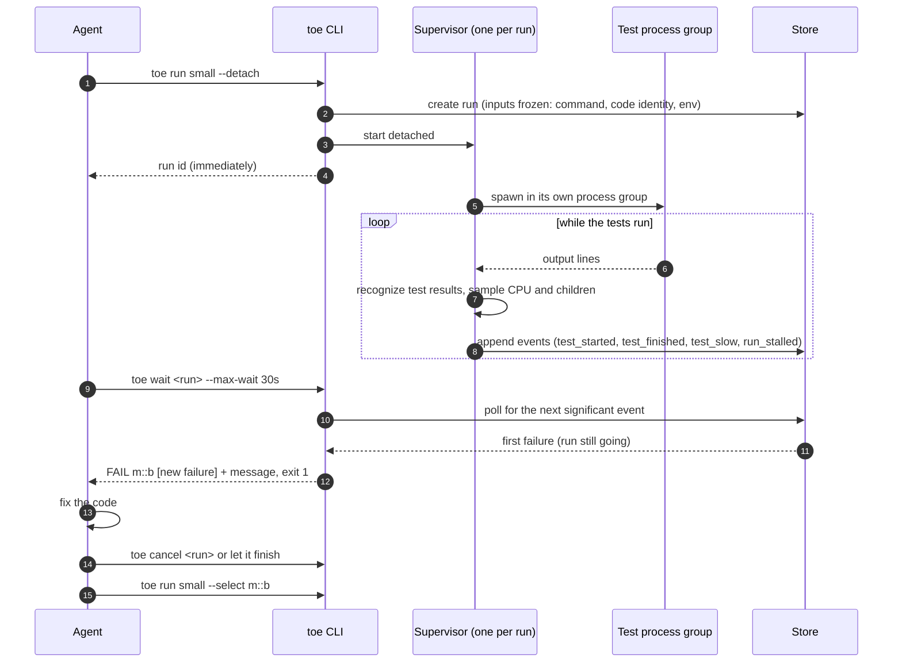
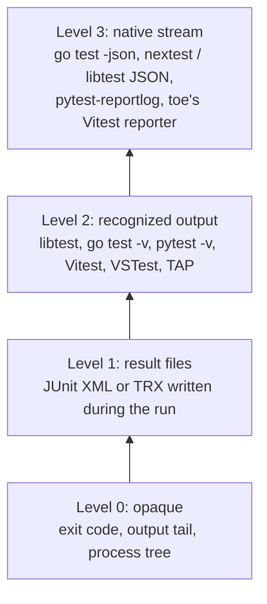
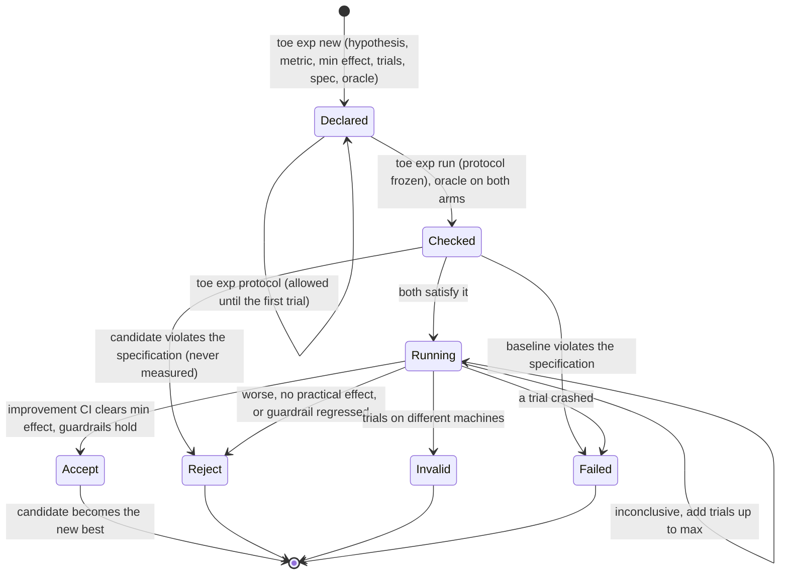
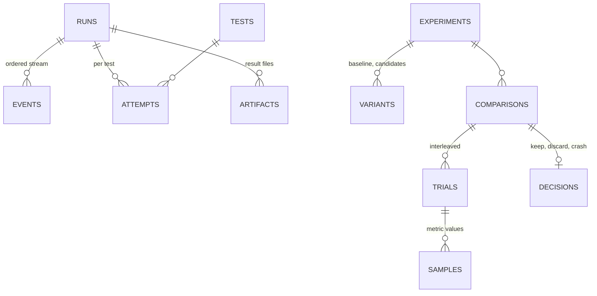

# Architecture

This document explains how toe works, for people and for coding agents.
It describes what toe does and why it is built that way.

- [The idea in one picture](#the-idea-in-one-picture)
- [Components and code map](#components-and-code-map)
- [The test loop](#the-test-loop)
- [Seeing tests: the fidelity ladder](#seeing-tests-the-fidelity-ladder)
- [Liveness: slow, stalled, killed](#liveness-slow-stalled-killed)
- [Memory: history and flaky tests](#memory-history-and-flaky-tests)
- [Experiments](#experiments)
- [Storage](#storage)
- [Deployment](#deployment)
- [Contracts for agents](#contracts-for-agents)
- [Invariants and where they are enforced](#invariants-and-where-they-are-enforced)

## The idea in one picture

Agents run tests badly: ad hoc shell commands, output dumped to files, long
timeouts, no memory of what failed before. toe puts one small binary between
the agent and the project's own test command. It runs that command, watches it,
tells the agent as soon as something needs attention, and remembers every run.


There is no daemon. `toe run` starts one supervisor process per run; every
other command reads and writes the same store directly.

## Components and code map

| Component | Code | Owns |
|---|---|---|
| Contract types | `crates/toe-core/src/model.rs`, `schemas/` | events, outcomes, fidelity levels; JSON Schema is generated and checked in CI |
| Lifecycle | `crates/toe-core/src/lifecycle.rs`, `spec/run.qnt` | which run transitions are legal; mirrors the Quint spec |
| Engine | `crates/toe-core/src/engine.rs` | creating runs, the supervisor, `wait`, summaries |
| Process control | `crates/toe-core/src/process.rs` | process groups, CPU and child sampling from `/proc`, signals |
| Store | `crates/toe-core/src/store.rs`, `migrations/` | SQLite schema and triggers that re-enforce the spec |
| Home and identity | `crates/toe-core/src/home.rs`, `identity.rs` | where data lives, repository identity, code identity, run origin |
| Analysis | `crates/toe-core/src/analysis.rs` | history, flake statistics, run diffs, observed sizes |
| Experiments | `crates/toe-core/src/experiment.rs`, `stats.rs`, `spec/experiment.qnt` | protocol, trials, Mann-Whitney + Hodges-Lehmann verdicts |
| Adapters | `crates/toe-adapters/src/` | recognizing live output, JUnit/TRX parsing, `toe adopt` detection, opt-in injection |
| CLI | `crates/toe-cli/src/main.rs`, `render.rs` | commands, exit codes, compact output |
| MCP facade | `crates/toe-cli/src/mcp.rs` | five tools that call the CLI with `--json` |
| Skills | `skills/`, embedded by `crates/toe-cli/src/skills.rs` | instructions agents load: workflows and one per language |
| Fixtures | `fixtures/` | one realistic project per supported language, used by large tests |

Dependency direction: `toe-cli` → `toe-adapters` → `toe-core`. The engine knows
nothing about frameworks; adapters plug in through the `Observer` trait.

## The test loop

The loop an agent runs, and what happens underneath:



`toe wait` never blocks longer than `--max-wait`. It returns on the first
failure, a slow test, a stall, or the end, and tells the agent the next command
to run.

## Seeing tests: the fidelity ladder

toe works on any command with zero configuration and climbs as high as the
output allows. Every result says
which level it reached, so the agent knows what it can trust.



- Live levels (2, 3) give the first failure while the run is still going.
- Result files (1) fill in tests the live output did not show, and never double count.
- When the framework's own totals exceed what toe saw (quiet output), the summary says so.
- Opt-in injection raises the level without editing the project's scripts, and is shown in every summary: `pytest-reportlog` (live stream), `pytest-junit` (report file), `vitest-stream` (toe's reporter; add `--reporter="$TOE_VITEST_REPORTER"` to the suite command), `go-nocache`.
- Streams that frameworks write to a file (pytest-reportlog, the Vitest reporter) are read live, like output, and kept as an artifact of the run.

## Liveness: slow, stalled, killed

Waiting is bounded; killing is explicit.


- Slow budget per test: three times its historical p95, else a default by size.
- Stall is measured on the whole process tree, so a busy compile is never a stall.
- Processes that outlive the run are reported as leaked and killed.

## Memory: history and flaky tests

Every attempt is stored with the code identity it ran on (git tree, plus a hash
of uncommitted changes). Each failure in a summary carries context:

| Tag | Meaning |
|---|---|
| `[new failure]` | not seen before with this message fingerprint |
| `[seen 3x before]` | a known, pre-existing failure |
| `FLAKY` | passed and failed on the same code, or passed on retry |
| `likely FLAKY` | the whole suite passed on exactly this code before |
| `last passed at tree:…` | the last code where this test was green |

`toe history <test>`, `toe flaky`, `toe diff <a> <b>` and `toe sizes` read the
same data.

## Experiments

For any claim that a change is better: faster, fewer steps, more accurate. A
protocol frozen before data, an optional specification that defines a correct
answer, interleaved trials, and a verdict.



The baseline is a git ref run in a worktree; the candidate is the working tree
as recorded (toe refuses a candidate whose files changed since). Statistics:
exact Mann-Whitney U, Hodges-Lehmann interval, Holm correction across an
improvement loop, verified against SciPy. Deterministic metrics (accuracy on a
fixed dataset, step counts) are valid samples.

**Metrics** come from the workload's output: JSON lines
`{"metric": .., "value": .., "unit": ..}`, or the native benchmark tools
`go test -bench`, criterion, pytest-benchmark, Vitest bench, JMH and
BenchmarkDotNet (times normalized to nanoseconds; `go test -count N` repeats
reduced to their median). `wall_ms` is always recorded. `toe exp metrics --
<cmd>` lists what a command yields.

**Specification first.** `--spec <file>` freezes the problem's specification
(Quint, Lean, a labelled dataset) by content hash in the protocol;
`--oracle <cmd>` (model checker plus trace conformance, property tests, a
proof build) runs once in each variant before any trial. Only implementations
that satisfy the specification are measured; a violator can never be
accepted. The gate is part of the experiment lifecycle spec
(`spec/experiment.qnt`). The `toe-spec` skill teaches writing the
specification, checking it, and turning it into an oracle.

## Storage

One toe home per user; the
project's folder keeps nothing.

```text
~/.local/share/toe/            (TOE_HOME)
  catalog.db                   repositories and where they were seen
  repos/<repo-id>/
    toe.db                     runs, events, tests, attempts, experiments
    runs/<run>/output.log      captured output (owner-only)
    artifacts/<sha256>         result files
    experiments/<id>/          trial logs
    worktrees/<commit>/        baselines for experiments
```

- The repository id comes from its first commit, so clones and worktrees share
  one history.
- Each run records where it ran: host, pod, node and actor (`TOE_ACTOR`, CI job or user).
- `toe status --all` and `toe flaky --all` read every repository in the home.



## Deployment

| Where the tests run | How toe gets there |
|---|---|
| A developer machine or agent sandbox | `cargo install`, or the release tarball |
| A container (devcontainer, CI image) | `COPY --from=ghcr.io/fals/toe:<version> /toe /usr/local/bin/toe` |
| CI (GitHub Actions, GitLab) | install or copy the binary; keep `TOE_HOME` in the job and persist it with the CI cache or artifacts |
| Pods in Kubernetes | same image copy; `TOE_HOME` on a volume with one writer at a time (no server; SQLite must not have several writers over network storage) |

toe always runs next to the tests, because only there can it watch and stop
the processes.

## Contracts for agents

These are stable interfaces; changing them is a breaking change.

**Commands** (all accept `--json`):

| Command | Purpose |
|---|---|
| `toe run <suite> [--select <test>] [--detach]` / `toe run -- <cmd>` | start a run |
| `toe wait <run> [--until first-failure\|stall\|done] [--after <seq>] [--max-wait 30s]` | next significant event |
| `toe cancel <run>` | stop the process group |
| `toe status [<run>] [--all]`, `toe output <run> [--tail N]`, `toe events <run>` | inspect |
| `toe history <test>`, `toe flaky`, `toe diff <a> <b>`, `toe sizes` | memory |
| `toe exp new\|candidate\|run\|wait\|status\|revalidate` | experiments |
| `toe init`, `toe adopt [--write] [--verify <suite> --filter <test>]` | adoption |
| `toe mcp` | MCP tools `run_start`, `run_wait`, `run_status`, `run_cancel`, `test_history` |

**Exit codes:**

| Code | Meaning |
|---|---|
| 0 | passed (or the command succeeded) |
| 1 | test failure (or experiment rejected) |
| 2 | usage error |
| 3 | stall, slow test, cancelled or killed |
| 4 | toe or infrastructure error |
| 5 | still running: call `toe wait <run> --after <seq>` |

**Events** are JSON Lines with schema [`schemas/event.v1.json`](../schemas/event.v1.json):
`run_started`, `test_started`, `test_slow`, `test_finished`, `run_stalled`,
`run_note`, `run_finished`. Each has `run`, a monotonic `seq` and `ts_ms`.

**Configuration** is optional: `toe.toml` names suites (`run`, `select` with
`{filter}`, `size`, `stall_after`, `kill_after`, `results`, `inject`).
Environment: `TOE_HOME`, `TOE_ACTOR`.

## Invariants and where they are enforced

Each rule is stated once in a spec and checked again at runtime.

| Invariant | Spec | Code | Database |
|---|---|---|---|
| Nothing is recorded after a run ended | `spec/run.qnt` | `Lifecycle` | trigger `events_only_while_open` |
| Terminal states are absorbing | `spec/run.qnt` | `Lifecycle::end` | trigger `runs_terminal_absorbing` |
| Run inputs never change | `spec/run.qnt` | — | trigger `runs_inputs_immutable` |
| No verdict before the minimum trials on both arms | `spec/experiment.qnt` | `Comparison::decide` | — |
| Protocol frozen at the first trial | `spec/experiment.qnt` | `experiment::set_protocol` | trigger `experiments_protocol_frozen` |
| Trials from different machines give no verdict | `spec/experiment.qnt` | `Comparison::decide` | — |
| Trials and attempts are immutable | — | — | triggers `trials_immutable`, `attempts_immutable` |

CI model-checks both specs and replays generated traces against the Rust state
machines.
